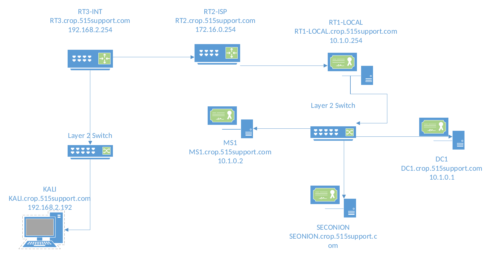

# Network Intrusion Detection with Security Onion and Snort


A network security monitoring project in which I deployed a Snort-based intrusion detection sensor on Security Onion, fed it traffic through Hyper-V port mirroring, and then attacked the network from a Kali Linux machine to see what the IDS caught. Along the way I triaged alerts in Sguil, tuned out a noisy rule, and analyzed the signatures fired by reconnaissance scans and a SYN flood.

The environment models a small corporate network, `corp.515support.com`, with an internal LAN behind a chain of routers leading out to a simulated internet. The sensor watches the LAN router's internet-facing interface, which is the natural place to spot hostile traffic coming in from outside.

---

## Table of Contents

- [Highlights](#highlights)
- [Network Topology](#network-topology)
- [Feeding the Sensor with Port Mirroring](#feeding-the-sensor-with-port-mirroring)
- [Monitoring and Triage in Sguil](#monitoring-and-triage-in-sguil)
- [Tuning Out a Noisy Rule](#tuning-out-a-noisy-rule)
- [Attacking the Network](#attacking-the-network)
- [Alert Analysis](#alert-analysis)
- [What I Learned](#what-i-learned)

---

## Highlights

The sensor received a copy of every packet crossing the router's internet-facing interface through Hyper-V port mirroring, without being placed inline. A simple ping from the attacker machine produced an ICMP alert that I traced to its Snort rule, then permanently disabled through PulledPork's `disablesid.conf`. An Nmap scan of the web server set off a burst of reconnaissance alerts, including a specific signature for Nmap OS detection. An `hping3` SYN flood with spoofed, random source addresses tripped Spamhaus DROP-list signatures, plus a shellcode signature that was most likely a false positive. I also confirmed the sensor's blind spot: traffic that never crosses the mirrored interface is never seen.

---

## Network Topology



| VM | OS | IP Address | FQDN | Role |
|----|----|-----------|------|------|
| RT1-LOCAL | VyOS | 10.1.0.254 | RT1.corp.515support.com | LAN router; its 172.16.0.x interface faces the ISP |
| RT2-ISP | VyOS | 172.16.0.254 | RT2.corp.515support.com | ISP router |
| RT3-INT | VyOS | 192.168.2.254 | RT3.corp.515support.com | Internet router |
| DC1 | Windows Server 2016 | 10.1.0.1 | DC1.corp.515support.com | Active Directory and DNS |
| MS1 | Windows Server 2016 | 10.1.0.2 | MS1 / updates.corp.515support.com | IIS web server (attack target) |
| SECONION | Security Onion (Ubuntu) | N/A (sniffing only) | SECONION.corp.515support.com | Network security monitor running Snort and Sguil |
| KALI | Kali Linux (Debian) | 192.168.2.192 | KALI.corp.515support.com | Attacker on the "internet" side |

The sensor has no IP address on the monitored segment. It only listens, which keeps it invisible to anything it is watching.

---

## Feeding the Sensor with Port Mirroring

An IDS can only detect what it can see, and a switch normally sends each frame only to the port it is addressed to. To give the sensor visibility, I configured **port mirroring** in Hyper-V Manager:

| VM | Adapter | Mirroring mode |
|----|---------|----------------|
| RT1-LOCAL | `eth1` (attached to the vISP switch) | **Source** |
| SECONION | `eth0` (attached to the vISP switch) | **Destination** |

With this in place, the virtual switch sends a copy of every frame entering or leaving RT1-LOCAL's internet-facing interface to the sensor, so Snort can inspect it without disrupting or slowing the real traffic. This is the virtual equivalent of a SPAN port on a physical switch. In a physical network, the same job could also be done by a **network TAP**, a dedicated hardware device inserted on the link that copies traffic to the sensor.

---

## Monitoring and Triage in Sguil

**Sguil** is Security Onion's real-time analyst console. It collects the alerts Snort generates and presents each one with its packet data and the rule that matched, so an analyst can investigate and categorize events instead of reading raw logs.

After starting Sguil on the `seconion-eth0` interface, I generated a simple test event by pinging DC1 (`10.1.0.1`) from Kali. The probes appeared as a single alert, and enabling **Show Packet Data** and **Show Rule** displayed the ICMP payload and the Snort rule, along with its SID, that produced the match.

I then explored Sguil's triage workflow through its right-click menus:

| Field | Action | What it does |
|-------|--------|--------------|
| CNT | View Correlated Events | Shows every individual packet grouped into the alert |
| Alert ID | Pivot menu | Opens the underlying traffic in tools such as Wireshark, NetworkMiner, or Bro |
| Src IP | Pivot menu | Looks up everything else stored about that address in the database |
| ST | Update Event Status → Cat VI | Categorizes the event as Reconnaissance/Probes/Scans and clears it from the queue; the record stays in the database |

**Confirming the blind spot.** Next I pinged DC1 from the LAN router itself. That traffic never crosses the ISP-facing interface, so the sensor never saw it and no alert appeared. It was a useful demonstration of why larger networks deploy sensors at several points and consolidate their feeds in a SIEM.

---

## Tuning Out a Noisy Rule

Not every alert deserves an analyst's attention. ICMP echo requests are routine, and alerting on every one buries real threats in noise. There are several ways to deal with a rule like this: auto-categorize its events in Sguil, add a threshold so it only fires after repeated matches, add conditions that narrow when it triggers, or remove it from the ruleset entirely. I chose to disable it.

Security Onion uses **PulledPork** to download and manage Snort rulesets, and its `disablesid.conf` file lists rules to switch off whenever the rules are rebuilt:

```bash
sudo nano /etc/nsm/pulledpork/disablesid.conf
# At the end of the file, add the rule's generator and signature IDs:
# 1:<SID>

sudo rule-update
```

After the update, pinging from Kali again produced no alert. Browsing to `updates.corp.515support.com` also stayed quiet, confirming that ordinary web traffic wasn't being flagged.

Disabling the rule through PulledPork rather than editing the rule file directly matters: the change survives future rule updates instead of being overwritten the next time the ruleset is refreshed.

---

## Attacking the Network

With the sensor tuned, I ran two intrusive tests from Kali against the IIS web server (`10.1.0.2`).

**Reconnaissance scan.** A Zenmap (Nmap) scan of the server set off a cluster of alerts, both for probes against sensitive ports such as SQL database services and for Nmap's own scan techniques. I categorized these in Sguil as reconnaissance with **F6**.

**SYN flood.** I then launched a short denial-of-service flood:

```bash
hping3 -c 1000 -d 120 -S -w 64 -p 80 --flood --rand-source 10.1.0.2
```

| Flag | Purpose |
|------|---------|
| `-S` | Send TCP SYN packets, the opening of a TCP handshake |
| `-p 80` | Target the web server's HTTP port |
| `-d 120` | Add 120 bytes of data to each packet |
| `-w 64` | Set the TCP window size |
| `--flood` | Send as fast as possible without waiting for replies |
| `--rand-source` | Spoof a random source IP on every packet |

Snort didn't flag the flood as a flood, but the random spoofed addresses gave it away from another angle, as described in the alert analysis.

---

## Alert Analysis

**ET DROP Spamhaus DROP Listed Traffic Inbound.** Spamhaus maintains the DROP ("Don't Route or Peer") list of netblocks controlled by criminals or hijacked for malicious use, and no legitimate traffic should come from them. Because `hping3 --rand-source` spoofed thousands of random source addresses, some inevitably fell inside DROP-listed ranges, and Snort flagged them. In a real network this alert is a strong, cheap indicator of hostile traffic, since it relies on threat intelligence rather than on recognizing the attack itself.

**GPL SHELLCODE x86 inc ebx NOOP.** This signature looks for a run of a specific x86 instruction used as a "NOP sled," a padding technique in buffer overflow exploits that steers execution toward injected shellcode. It fired during the attack phase, but neither test actually delivered an exploit. This is most likely a **false positive**, where filler bytes in the attack packets happened to match the pattern. That's worth recognizing in triage: a scary-sounding alert still has to be checked against what was actually happening.

**ET SCAN NMAP OS Detection Probe.** Nmap identifies a target's operating system by sending specially crafted packets and comparing the responses to known fingerprints. Snort recognizes those probes as reconnaissance, a sign that someone is mapping the network and looking for OS-specific vulnerabilities, which is often the first step of an attack.

---

## What I Learned

This project showed how a network IDS works end to end: getting traffic to the sensor, matching it against signatures, and turning alerts into triaged, categorized events. Sensor placement turned out to be just as important as the rules, since the sensor was completely blind to traffic that didn't cross the mirrored interface. Tuning was the other half of the job. Disabling the ICMP rule showed that a useful IDS is one where every alert is worth reading, and doing it through PulledPork showed that tuning has to survive rule updates.

Analyzing the attack alerts was the most interesting part. The SYN flood was never identified as a flood, yet it was still caught through threat intelligence on its spoofed sources. The shellcode alert looked severe but was almost certainly a false positive. Together they showed that an analyst needs to understand *why* a signature fires, not just *that* it fired, before deciding what an alert really means.

---

## Author

**Geoffrey Mackey**, Cybersecurity Professional and Student at the University of Cincinnati.
